# AUGUR

**A language model trained on nothing published after 1938, asked what year it is, answers 1899. Asked again two months later, 1900.**

> **Correction, 2026-10-21 (v1.0.4).** The core result reproduced on a re-run with per-model date anchors. One section of the first version, the "elicitation framing" finding, is withdrawn: its quotations came from an unsaved demo session and did not come back on the re-run. Details in [`FINDING.md`](FINDING.md#correction-2026-10-21-v104) and [`AUDIT-RERUN-2026-10-21.md`](AUDIT-RERUN-2026-10-21.md).

Not as a joke, and not as a hallucination it can be talked out of. Ask it about the most
recent war and it reaches for Crimea. Ask who is President and it says George Washington.
Tell it firmly that the year is 1938 and it politely declines to move.

That gap - between the date on the tin and the date the model actually speaks from - turns
out to be large, consistent, and measurable. This repository is what happened when I went
looking for it.

## The thing everyone assumes

A handful of research groups have started training language models from scratch on text
that stops at a fixed historical date. The appeal is obvious. Ordinary models are soaked in
hindsight; you cannot ask GPT what it thinks will happen in 1939, because it knows. A model
whose training corpus ends in 1938 is supposed to be genuinely, structurally ignorant of
what came next - a way to ask the past a question and get the past's answer.

The assumption riding along underneath is that **a model with a 1938 cutoff represents
1938.** It is such a natural assumption that it mostly goes unstated. It is also wrong.

## A cutoff is a wall, not an address

Here is the way of thinking about it that I keep coming back to.

A knowledge cutoff describes the *edge* of the training corpus. It says nothing about where
the *weight* of that corpus sits. Imagine a library assembled from everything printed
before a certain year: the shelves are not even. Digitised, out-of-copyright, heavily
reprinted material piles up in the nineteenth century. The last two decades before the
cutoff are comparatively bare - still in copyright, less scanned, less reprinted, less
argued over.

Ask that library what time it is and it will not answer from its newest shelf. It answers
from its centre of gravity.

So the useful quantity is not the cutoff at all. It is what I have been calling the
**effective epistemic date**: the year a model speaks from when nobody tells it otherwise.
On the two models tested here, that date sits **four to eight decades before the stated
cutoff**. A model advertised as 1938 lives in the 1890s. A model advertised as 1930 lives
somewhere around 1850, naming Bismarck as a sitting Chancellor and Grover Cleveland as a
sitting President.

Two models, built by different teams, from different corpora, at different sizes and
quantisations. Both drift backwards, and both drift far.

## The second dimension, which is where it gets interesting

The obvious fix is to tell the model what year it is. That works. Sometimes.

Given a single sentence of the form *the year is 1930*, one of the two models jumps forty
years on the spot - the same model that had just named a President from the 1880s correctly
identifies Herbert Hoover, his election in November 1928, his inauguration, and the date his
term expires. The late knowledge was in the weights the whole time. It simply was not the
default.

The other model, given the same treatment, does not move at all. It hedges, then invents:
it produces a President who was re-elected over a man who had in fact succeeded him, and
elsewhere confabulates a Chancellor holding office in a year it has never read about.

So a time-locked model has to be characterised along **two** axes, not one: where it stands
when unprompted, and whether it can be led somewhere else. A model that relocates on command
is a usable historical instrument. A model that cannot is a very confident antique that will
answer your 1938 question from 1899 and never signal the substitution.

The practical rule falls straight out: **anchor the date, then verify the anchor took.** On
half the models tested, it did not.

## A second finding I had to withdraw

The first version of this write-up had a section here called "What the corpus remembers depends on
what you ask it". It quoted the 1930 model, anchored to 1930, calling another great war highly
improbable, and then, asked instead to enumerate the dangers facing Europe, naming the Rhineland,
Poland and Czechoslovakia, the Italo-Yugoslav quarrel and Russia. Same model, same year, flatly
contradictory answers; the form of the question decides which 1930 you meet.

Those quotations came from an interactive demo on the day of the first run, and the demo was never
saved. They are in no committed transcript. When I re-ran the battery on 2026-10-21 (with the anchor
bug below fixed), the model still said no to another war, but on different grounds, and the dangers
it listed were "the spread of Socialism", "renewed hostilities between France and Germany" and "a
general war". The direction of the effect is faintly there; the accurate, specific threat list that
made the demo worth writing about is not.

So the framing claim is withdrawn as a finding. It stays in `FINDING.md` as a hypothesis with the
original quotations labelled as unsaved, and it will need a saved, anchored pair of probes before it
is claimed again. The two things a corpus holds, its reassurance and its alarm, may still coexist in
these weights; this repository no longer shows it.

Two other corrections from the same audit. The first run's script anchored both models to 1938, so
the "given the year is 1930" wording in the first version was not what the Talkie-1930 model received;
the re-run anchors each model to its own cutoff and the recoverability split holds either way. And
outputs at temperature zero and a fixed seed are not bit-identical across sessions on this machine:
the years and names reproduce, the wording does not, so every quotation here is illustrative.

## Why any of this is worth writing down

Vintage models are already being used to reconstruct historical belief spaces. If those
studies query without a date anchor, they are sampling from decades before the year they
report, and presenting it as the year on the label.

There is also a quieter methodological trap. Both models here **hallucinate forward**: they
produce post-cutoff dates while having no post-cutoff knowledge - a Chancellor "in office
since 1940" from a model that has never read about 1940. Any contamination check that works
by scanning outputs for future years will flag these as leaks. They are not leaks. They are
confabulation that happens to be numeric.

## Prior work, and what is actually mine

The idea that a model's reported cutoff is not its real one is not mine. **Dated Data: Tracing
Knowledge Cutoffs in Large Language Models** (arXiv:2403.12958; Cheng, Marone, Weller, Lawrie,
Khashabi and Van Durme, 2024) defines an *effective cutoff*, distinct from the designer-reported
one, estimates it by probing mainstream LLMs across dated versions of their training resources, and
finds the two routinely disagree. It also traces the cause into the corpus: CommonCrawl dumps carry
non-trivial amounts of old data, and deduplication does not remove semantic and near-duplicate
repeats. That is the corpus-mass mechanism, already established, on real production models. I am not
claiming it.

What is left, and what this repository actually adds:

- **Uncontaminated by construction.** Dated Data measures models trained on everything up to a
  recent date. These models were trained on nothing after 1938 and 1930 respectively, by teams with
  no stake in this question. There is no hindsight to leak, so no leak-detection argument is needed.
- **Decade-scale, not months.** An effective cutoff that lands a few months early is a data-curation
  problem. One that lands **40 to 85 years** early is a different claim about where a corpus's centre
  of gravity sits relative to its edge, and it is only visible when the corpus is deliberately thin
  and old.
- **Behavioural self-report, not resource probing.** The measurement here is the model answering
  "what year is it?" and naming a sitting president. That is the model's own account of when it is,
  which is what a downstream user of a vintage model actually encounters.
- **Relocatability, which is a second axis entirely.** Whether telling the model the year recovers
  the knowledge is not in the prior work. One of these two models moves and answers accurately; the
  other does not move at all. A study using vintage models cannot know which case it is in without
  testing.

Read together: Dated Data says the effective cutoff differs from the reported one and explains why.
This says that on time-locked models the gap is decades rather than months, that the model will tell
you so if you ask it directly, and that whether you can talk it forward varies by model and is worth
measuring on its own.

## What this is not

It is two models. That is replication, not a law.

The confounds are real and I have not controlled them: the two differ in parameter count
and in quantisation as well as in corpus, and the larger model outperforms the smaller on
every probe - so some part of the smaller model's refusal to relocate may be capacity
rather than corpus composition. A third family, or the same family at a second size, would
separate those. The effective epistemic date is estimated from a fourteen-probe battery
run at temperature zero; the years and names reproduce across two runs two months apart, the
wording does not, so it is a real effect rather than a calibrated measurement.

One more, and it is the one that could cut the headline in half. The 1938 weights are a
third-party GGUF conversion whose model card lists the 1913 base model and says its author does
not know which model is which. If that file is the 1913 model, TypeWriter's gap is thirteen
years, not thirty-nine, and the eighty-year Talkie result carries the claim on its own. Until the
maintainers answer, read the 1938 label with that doubt attached.

I would rather say that plainly than round it up.

## The numbers, and how to re-run them

Everything above is argued from evidence that lives in this repository:

- **[`FINDING.md`](FINDING.md)** - the claim, the full probe-by-probe comparison table, the
  recoverability split, and the caveats stated without softening.
- **[`PHASE0-RESULTS.md`](PHASE0-RESULTS.md)** - the first model in depth, including the
  harness bug that had to be ruled out before any of this could be believed.
- **[`probes-typewriter-1938.md`](probes-typewriter-1938.md)**,
  **[`probes-talkie-1930.md`](probes-talkie-1930.md)** - raw model output, unedited (2026-08-23,
  both anchored to 1938 by the runner bug).
- **[`probes-typewriter-1938-rerun-2026-10-21.md`](probes-typewriter-1938-rerun-2026-10-21.md)**,
  **[`probes-talkie-1930-rerun-2026-10-21.md`](probes-talkie-1930-rerun-2026-10-21.md)** - the re-run
  with per-model anchors; **[`AUDIT-RERUN-2026-10-21.md`](AUDIT-RERUN-2026-10-21.md)** compares the two
  runs claim by claim.
- **[`run_probes.ps1`](run_probes.ps1)** - the battery. Temperature 0, fixed seed, identical
  fourteen probes to both models; `-AnchorYear` sets the date anchor (1938 or 1930).
- **[`PLAN.md`](PLAN.md)** - the original design, including the forecasting programme that
  Phase 0 falsified. Left in deliberately; the plan being wrong is part of the result.

Model weights are not in the repository. Both are public GGUF releases and
`PHASE0-RESULTS.md` names them, along with the one detail that will otherwise cost you an
afternoon: the local runner did not apply the chat template (the GGUF does embed one, but Ollama
reported the model as completion-only), and it will silently treat an instruct model as a base
completion model if you let it; the Modelfiles in `PHASE0-RESULTS.md` set the template explicitly. Every answer will be fluent
nonsense and none of it will be the model's fault.

## A note on the name

An augur read the future in the flight of birds. The joke is that these models cannot read
the future at all - the finding here is that they cannot reliably read their own present
either.

## Copyright, citation, and provenance

**Copyright (c) 2026 Zaid Ali Syed.** ORCID [0009-0003-4313-1510](https://orcid.org/0009-0003-4313-1510).

Two licences, because there are two different things here. The **code** is MIT - see
[LICENSE](LICENSE) - and you may use it with the copyright notice retained. The **written analysis
and the probe design** are the archived record on Zenodo, released under
[CC BY 4.0](https://creativecommons.org/licenses/by/4.0/): free to reuse and build on, attribution
required. If you build on the findings, cite the record rather than reproducing the text:

> Syed, Z. A. (2026). *AUGUR: The Effective Epistemic Date of Time-Locked Language Models*.
> Zenodo. https://doi.org/10.5281/zenodo.22309658

The DOI above is the concept DOI: it always resolves to the newest archived version. Machine-readable
metadata is in [`CITATION.cff`](CITATION.cff), and GitHub's "Cite this repository" panel reads it directly.

Every commit here is signed with ed25519 key `EFE9 4832 B2B9 80D9 B583 91F2 8FAA BCC1 B1AC 09E5`
and shows as Verified on GitHub. A commit in my name without a valid signature was not made by me.

---

One plate from the survey at [github.com/zaidwhy](https://github.com/zaidwhy). The strip on the plate above is this repository's own commit history, one band per week.
